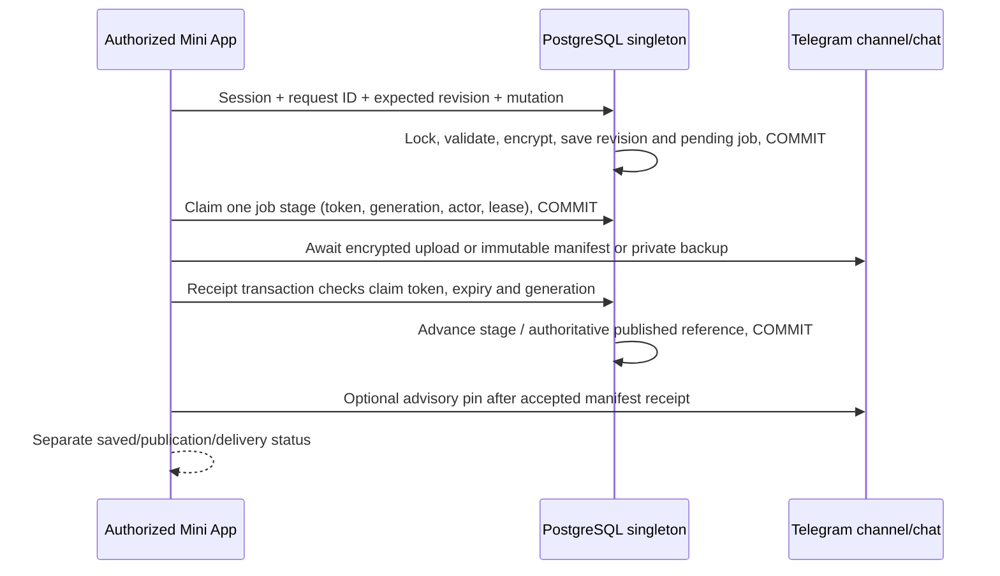

# Architecture, guarantees and verification

Reviewed 2026-11-01 (Asia/Dhaka). The production coordinator is implemented; actual cloud provisioning and live integration remain operator steps. Tests and provider facts are separated below. Setup: [SETUP_BN.md](SETUP_BN.md).

## Selected service and storage boundary

**Neon PostgreSQL Free** was chosen for one pooled PostgreSQL URL, a SQL Editor migration and standard row-locking transactions. No separate Redis/Firebase/Supabase service, persistent server or paid worker is required. [Current official pricing](https://neon.com/pricing) and [plans](https://neon.com/docs/introduction/plans) were read: Free is $0 with no card, 100 CU-hours/month and 1 GB database storage per project, 5 GB public transfer. Idle compute suspends after five minutes. Free compute/network exhaustion suspends compute; storage-increasing operations fail at the cap. Paid Launch is optional usage-based ($0.106/CU-hour, $0.35/GB-month plus other features). No paid service was authorized/provisioned; stay on Free and check usage in the Console.

The only generic plaintext database fields are singleton ID, schema/version and updated timestamp. AES-GCM seals the whole application state under private SERVER_KEY. Inside that ciphertext are one vault account UUID/username/binding/generation, session-token hashes, wrapped unlock keys, auth-attempt counters, short-lived callback/event IDs, mutation idempotency records, intended revision, authoritative published reference, reference history, outbox claims/receipts, a latest encrypted snapshot cache and pending encrypted snapshots. **This is not a metadata-only database:** it temporarily stages encrypted documents and caches the latest envelope. It never stores plaintext vault contents, master passwords, TOTP seeds or recovery keys. Completed old document ciphertext is compacted out of coordinator jobs; old Telegram documents/manifests are retained. At most five unresolved private backups may be queued; encrypted state has a 24 MB hard cap and fails closed rather than discarding work.

Telegram private channel holds versioned encrypted documents and immutable signed manifests, with private-chat copies sent to the currently active owner. Downloaded encrypted files and independent recovery tools are the disaster-recovery path outside Telegram. A file only in Telegram is not an independent backup.

## Verified official capabilities

| Source read | Verified capability/constraint used |
|---|---|
| [PostgreSQL explicit locks](https://www.postgresql.org/docs/current/explicit-locking.html) | `SELECT ... FOR UPDATE` excludes competing locks/writes until transaction end; subsequent READ COMMITTED locker gets the updated row |
| [node-postgres transactions](https://node-postgres.com/features/transactions), [TLS](https://node-postgres.com/features/ssl) | All transaction statements use one checked-out client, explicit BEGIN/COMMIT/ROLLBACK; URL SSL options can override an SSL object, so production strips those options and explicitly verifies TLS |
| [Neon pooling](https://neon.com/docs/connect/connection-pooling) | Pooled `-pooler` URL is suitable for serverless; PgBouncer transaction pooling supports transaction-bound state, not reliance on session locks/settings |
| [Telegram Mini Apps](https://core.telegram.org/bots/webapps#validating-data-received-via-the-mini-app) | Backend validates initData HMAC with WebAppData-derived key, sorted signed fields and auth_date; initDataUnsafe is not trusted |
| [Telegram Bot API](https://core.telegram.org/bots/api) | getChat can return a pinned message, getFile resolves file IDs, sendDocument supports multipart; channels require admin posting/edit rights; channel pin uses can_edit_messages |
| [Telegram ID conversion](https://core.telegram.org/api/bots/ids), [message links](https://core.telegram.org/api/links#message-links) | A private t.me/c link uses MTProto channel ID; Bot API ID is `-(1000000000000 + id)`, not arbitrary string prefixing |
| [Vercel limits](https://vercel.com/docs/functions/limitations) | Request/response payload maximum is 4.5 MB; runtime duration and resources are bounded |
| [Vercel cron usage](https://vercel.com/docs/cron-jobs/usage-and-pricing), [cron management](https://vercel.com/docs/cron-jobs/manage-cron-jobs) | Hobby supports daily cron with hour-level precision; CRON_SECRET is sent as a Bearer Authorization header |

Bots.Business hosted docs were inaccessible through the tool; its **official documentation GitHub repository** was read at `55fad10df874fbecd68c8ffee282bb1e8d589ff5`:

- [HTTP](https://github.com/bots-business/help/blob/55fad10df874fbecd68c8ffee282bb1e8d589ff5/bjs/http.md): uppercase HTTP.post supports exact string bodies/headers, separate success/error commands, five-second network timeout, and the option spelling `folow_redirects`. Responses arrive later as content/http_status, not synchronous returns. Its documented transport does **not validate HTTPS server certificates**.
- [Context](https://github.com/bots-business/help/blob/55fad10df874fbecd68c8ffee282bb1e8d589ff5/bjs/context.md): user.telegramid is a Telegram ID, user.id is internal BB ID, original tgUpdate may be supplied. Commands fail closed without that original context and cross-check sender/private chat.
- [Properties](https://github.com/bots-business/help/blob/55fad10df874fbecd68c8ffee282bb1e8d589ff5/bjs/user-properties.md): ordinary property read-modify-write is not atomic; simultaneous executions and lookup-cache behavior rule it out as this coordinator. [App property editor](https://github.com/bots-business/help/blob/55fad10df874fbecd68c8ffee282bb1e8d589ff5/app/properties.md) documents scope, Name/Type/Value and save/reopen checks.
- [Inline callbacks](https://github.com/bots-business/help/blob/55fad10df874fbecd68c8ffee282bb1e8d589ff5/bjs/inline.md): callback data dispatches a command, 1–64 bytes, callback IDs/message IDs are different, and callbacks are input rather than authorization.
- [Files](https://github.com/bots-business/help/blob/55fad10df874fbecd68c8ffee282bb1e8d589ff5/guides/send-media.md): uploads yield file_id, Api document methods accept supported file IDs/URLs; a local project path is not a Telegram upload. Sensitive import bytes stay in HTTPS forms here.
- [CryptoJS](https://github.com/bots-business/help/blob/55fad10df874fbecd68c8ffee282bb1e8d589ff5/libraries/utilities.md): runtime HmacSHA256 supports signing the exact request string. [Git](https://github.com/bots-business/help/blob/55fad10df874fbecd68c8ffee282bb1e8d589ff5/integrations/git.md) documents default-branch mobile import and destructive command/library replacement, including on failed imports; [repository format](https://github.com/bots-business/help/blob/55fad10df874fbecd68c8ffee282bb1e8d589ff5/integrations/repository-format.md) requires root bot.json/commands.

These are documentation/source verifications, **not live integration tests**. Real Mini App clients, BB runtime string forwarding, Vercel routing/TLS to Neon and actual Telegram channel permissions still need the acceptance steps. Vercel memory and temporary files are not persistent storage; no in-memory mutex is used as distributed synchronization. Telegram Bot API is not a general-purpose channel history/search database. A bot is added as channel admin, never “logged in” to the channel. BB owns updates; the backend never sets/deletes webhooks or polls getUpdates.

## Durable authentication and mutation ordering

`sql/001-coordinator.sql` creates the singleton row **before** registration. `PostgresCoordinator.run`:

1. Gets one pool client, BEGIN, transaction-local lock/statement/idle timeouts.
2. Reads singleton 1 with FOR UPDATE and validates schema. Missing row/table, wrong key, corruption or connection failure does not create a new empty vault.
3. Authenticates/decrypts its state, executes the callback exactly once (no transparent transaction retry), seals/updates state and increments its database version, COMMIT.
4. Commits expected `Fault` rejections such as wrong credentials so login-attempt counters remain durable. Unexpected failures roll back. Connection-loss/ambiguous commit outcomes return sanitized 503 and never automatically rerun the callback.

Sensitive service checks and data mutations are in this same transaction. A new account, its binding, acknowledgement state, generation and session creation are atomic. A single human can issue concurrent requests from retries/tabs/devices; PostgreSQL ordering handles all such instances. Revision checks detect stale edits **after serialization**; they are not the lock.

A strong external one-time setup token gates the first account. Account creation permanently closes setup even while recovery acknowledgement is pending. Sessions contain generation, actor, idle and absolute expiry, and an AES-GCM-wrapped DEK. Only bearer hashes are durable; plaintext bearer tokens stay in browser memory. Idle expiry defaults to 600 seconds (configurable 60–3600); absolute lifetime is one hour. Every sensitive request checks session, current generation and active binding. Native menus use the configured idle timeout too. Logout deletes the session/callbacks server-side. Expired sessions, obsolete callback state and scoped idempotency records are pruned; expired bot-event markers are also pruned.

Login/password recovery use a vault-global durable five-attempt/15-minute window. Username failures count; changing IP or Telegram account does not create another budget. This can permit denial of service against a personal vault but cannot be bypassed by cold starts. Rebind requires username + password + recovery key + explicit revocation confirmation. Forgotten-password recovery separately requires username + recovery key + new strong password + confirmation. Both revoke sessions/callbacks and job ownership, increment generation and bind the new actor. Rebind preserves vault UUID and records; password recovery also wraps the data key under the new password and saves a new encrypted revision.

Mutation idempotency uses current session hash + caller request ID and content digest. A repeated authorized request returns its old revision; different content with the same key conflicts. Expired/revoked sessions cannot revive an old request. The browser uses expected revision to prevent stale accidental repeats from creating a second mutation, and API callers can retry the exact body/request ID after an ambiguous response. Pure callbacks are required: **no Telegram/HTTP effects execute inside SQL transactions**. Bot menu effects are assembled durably, then generation/session are checked again before dispatch outside the transaction.

Do not reset/reseed the singleton row or restore an old security-state database on a live deployment. A database administrator can roll back security history; that is inside the trust boundary. App backup restore copies records only and never restores a binding/session. Recovery after database/key loss uses a new deployment and portable backup; it does not reopen old public registration.

## Outbox, publication and crash safety

The worker uses 45-second leases and random per-claim fencing tokens. It claims/commits under the singleton lock, performs one awaited effect **outside** the SQL transaction, then commits the receipt only if token, expiry, actor and auth generation still match. Concurrent workers cannot both advance the same stage. A killed worker leaves durable pending work; a later invocation can reclaim an expired lease. New channel publication is prioritized over older failed private delivery. Rebinding clears old leases and generation fences their results; the next private delivery targets the new binding.

A slow expired worker may still complete a Telegram request. **Every revision has an immutable signed manifest; no existing manifest is edited to declare it current.** Thus an old remote send creates only an orphan/duplicate; its fenced receipt cannot replace the coordinator's newer current reference. The authoritative published pointer includes vault UUID, revision, encrypted document file ID, manifest message ID and file digest. It advances monotonically in a transaction after successful manifest sending. Pin updates are best-effort, separate advisory effects; their failure does not undo actual channel publication. A delayed pin can be stale. Discovering a pinned hint requires matching its HMAC/vault/revision/hash against the durable published reference; it never overrides that reference or reconstitutes revocation state from history.

Save status distinguishes:

- **Vault saved:** new intended encrypted revision + outbox are durably committed.
- **Upload:** document file reference recorded, but publication may still be pending/failed.
- **Channel published:** immutable signed manifest sent and authoritative reference committed. A failed publication blocks the next mutation.
- **Private backup delivered:** Telegram acknowledged the encrypted private-chat send and the valid receipt was committed. Delivery failure does not roll back saved/published data.

The immutable manifest contains vault UUID, schema, revision, creation time, predecessor digest, document file/message IDs, encrypted-file SHA-256 and HMAC-SHA256. There are no account labels, passwords, seeds or personal notes in captions/filenames/manifests. Filename is `vault.encrypted.json`; caption contains only a generic encrypted-snapshot description and revision.

Each request tries at most three stages, stops starting further stages after its budget, uses bounded Telegram calls, and awaits all work. User Retry resumes immediately. Vercel's daily `/api/worker` cron is an authenticated unattended fallback, compatible with Hobby; it is not a permanent 30-second process or a detached promise. The schedule is `0 3 * * *` UTC, approximately 09:00 Asia/Dhaka with Hobby's hourly scheduling precision. Failed/aborted receipts and quota/network outages stay pending. Multiple queued deliveries can require multiple invocations.

Exactly-once Telegram delivery is **not** promised: a send may succeed before a timeout/crash/receipt failure, so a retry can create duplicate encrypted documents/manifests/backups. Already-dispatched Telegram content cannot be recalled reliably. Rebind/logout prevent new authorization and obsolete receipts; they cannot erase a request already in flight, downloaded files, clipboard values or delivered chat history. Native TOTP disclosure is explicit and warns about chat history; passwords reveal in the web UI.

## Encryption and trust model

**Not zero-knowledge:** the backend receives master/recovery credentials over HTTPS and decrypts records. Trust includes backend code/hosting administrators, SERVER_KEY storage, the user's browser/device and Telegram for explicitly disclosed native codes. A malicious backend can steal credentials; browser extensions/clipboard managers can capture reveals.

Backups have a random independent vault UUID and 256-bit DEK. Node crypto AES-256-GCM uses a fresh 96-bit cryptographic random nonce and 128-bit tag for every encryption. Random nonce uniqueness is probabilistic, with negligible collision risk at this personal workload. Scrypt uses per-vault random salt, recorded N=32768/r=8/p=1 (64 MiB maxmem); password length 14–256 with at least eight distinct characters is enforced. Password-based and separate 256-bit recovery-key wrappers unlock the DEK. AAD binds purpose/vault/schema; payload AAD additionally binds revision/time/predecessor digest, KDF metadata and both complete wrappers in stable field order. Backup authentication is portable without SERVER_KEY, Telegram, Neon or an old Vercel environment.

Unlock keys between requests are wrapped under SERVER_KEY with actor/generation-bound AAD; the full database state is also encrypted. Request buffers are cleared where practical; JavaScript strings/GC/browser CryptoKeys cannot guarantee complete memory erasure. No plaintext unlock keys or bearer sessions are stored in BB properties. No secrets are written to source/logs/analytics/callbacks/query strings. Parameters such as `?view=setup` select forms only; no password/token/recovery credential belongs in a URL.

BB sender forwarding derives IDs from original tgUpdate, cross-checks runtime sender/private chat, signs exact JSON bytes with CryptoJS.HmacSHA256 and includes event/freshness. The shared signing key is not sent over BB's certificate-unverified HTTP transport. Responses are ignored; the backend uses TLS-verified Telegram API calls to send menus directly. HMAC authenticates metadata but does not hide metadata or prevent denial of service. A stolen forwarding key can forge navigation provenance, but vault access still requires a valid currently bound session; username labels are never ownership proof. Secrets remain in HTTPS forms; imports do not traverse Telegram chat.

Application limits are stricter than Vercel's 4.5 MB ceiling: 3.5 MB JSON requests, 1 MiB import source, encrypted committed snapshot under 2.5 MB, 5000 records and per-field bounds. No third-party favicon requests or analytics disclose stored domains. TOTP is computed from current time on demand with preserved SHA1/SHA256/SHA512, digits and period; codes are never stored and browser countdowns need no server timer.

## Recovery and verification boundaries

Downloaded backups authenticate and validate before preview. Merge/Replace imports records only; explicit Replace confirmation is mandatory, explicit links are remapped when IDs change and previous channel documents are retained. Offline browser recovery and hidden-input CLI work without Telegram/initData/Neon/old server credentials; plaintext export is clearly labelled. A downloaded backup is a separate artifact from Telegram history.

Executed: 27 unit/mocked integration tests, 10 **real local PostgreSQL 17** integration tests, and a real Chromium mobile/offline-recovery smoke. Separate PostgreSQL clients test setup races, row-lock ordering, concurrent/idempotent saves, durable throttling/revocation/expiry, rebind and stale callbacks, publication/delivery failures, expired owners, wrong keys/missing rows and authenticated HTTP production routes. Telegram is mocked in these tests. Browser recovery was verified after static files loaded with networking disabled; managed Chromium blocks direct file:// navigation. Standalone CLI recovery is verified without old environment credentials.

No Neon cloud project, actual Telegram/BB integration, real Mini App launch, Vercel redeploy or hosted cron execution was performed. The code-level production blocker is resolved by a tested durable adapter; operator configuration and live acceptance remain required. See STATUS.md and SETUP_BN.md. No paid service or webhook change was made.
